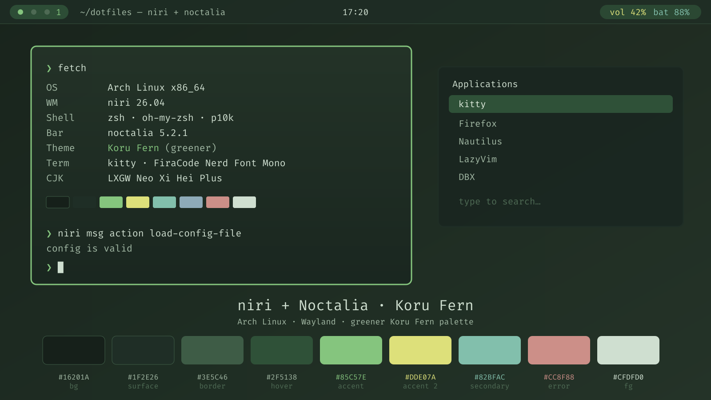

# niri + Noctalia · Koru Fern (greener)

[中文](README.md) · **English**



A desktop configuration for **Arch Linux + [niri](https://github.com/YaLTeR/niri)
(scrolling tiling Wayland compositor) + [Noctalia](https://noctalia.dev) v5**
(all-in-one shell: bar / launcher / notifications / clipboard / OSD / wallpaper / lock screen),
themed after the **Koru Fern** palette, hue-shifted **towards green**:
dark green-charcoal base + fern green accent + soft yellow.

> This repo is a snapshot exported from a live machine: configs + install scripts + a reproduction guide.
> Fonts are **not** committed (too large) — a script downloads them.
> The image above is a **mock-up** drawn from the palette; see [`screenshots/`](screenshots/README.md)
> for how to add real screenshots.

---

## Contents

- [What it looks like](#what-it-looks-like)
- [Palette](#palette)
- [Requirements](#requirements)
- [Dependencies](#dependencies)
- [Quick start](#quick-start)
- [Manual reproduction](#manual-reproduction)
- [File map](#file-map)
- [Fonts](#fonts)
- [zsh](#zsh)
- [Noctalia notes](#noctalia-notes)
- [niri keybinds](#niri-keybinds)
- [niri layout & animations](#niri-layout--animations)
- [Known issues](#known-issues)
- [Optional: coexist with the waybar setup](#optional-coexist-with-the-waybar-setup)
- [Credits & license](#credits--license)

---

## What it looks like

- **Compositor**: niri `26.04` (Wayland). Windows have a 12px corner-radius region, 4px gaps, global frosted glass (translucent + background blur).
- **Shell/bar**: Noctalia `5.2.1`, dark mode + custom palette `KoruFern` + glassy dropdown panels.
- **Terminal**: kitty (`FiraCode Nerd Font Mono` 14pt, 0.8 background opacity, no window decorations).
- **Input method**: fcitx5 (rime) + a custom `koru-fern` fcitx5 theme.
- **Wallpaper**: `koru-fern.png` / `koru-logo.png` (see `wallpapers/`).
- **Login**: greetd (optionally with `noctalia-greeter`).
- **Shell**: zsh + oh-my-zsh + powerlevel10k (prompt colored with the same Koru Fern palette).
- **Fonts**: see [`fonts/README.md`](fonts/README.md).

---

## Palette

The core colors ("greener" Koru Fern), hard-coded in `config/niri/noctalia.kdl`,
`config/noctalia/palettes/KoruFern.json`, `config/kitty/themes/noctalia.conf` and
`local/share/fcitx5/themes/koru-fern/theme.conf`:

| Role | Value | Used for |
|---|---|---|
| background `bg` / `mSurface` | `#16201A` | niri `layout background-color`, `overview backdrop-color`, terminal background |
| surface `surfaceVariant` | `#1F2E26` | IM panel background, inactive border |
| accent `mPrimary` | `#85C57E` | focused border, selection, terminal color2 |
| soft yellow `mTertiary` | `#DDE07A` | highlights, terminal color3 |
| border `mOutline` | `#3E5C46` | IM panel border, separators |
| hover `mHover` | `#2F5138` | selection background (terminal selection) |
| foreground `mOnSurface` | `#CFDFD0` | text |
| muted `mOnSurfaceVariant` | `#A2B8A4` | secondary text |
| error `mError` | `#CC8F88` | urgent border, terminal color1 |

The original Koru Fern comes from `koru-nixos-dotfiles/system/theme.nix`; here every hue is shifted slightly toward green.

---

## Requirements

- **Arch Linux** (other distros work too — mind the package names). A Wayland session.
- Display: tuned for `eDP-1 2560x1440@165Hz, scale 1.5`. **Change**
  `output "eDP-1" { ... }` in `~/.config/niri/config.kdl` for other resolutions/scales.
- GPU: used on an NVIDIA RTX 3050 Mobile (nvidia-drm `modeset=1`); no special handling needed for AMD/Intel.
- Login: `greetd`.

---

## Dependencies

### Arch official repos

```bash
sudo pacman -S --needed \
    niri noctalia \
    kitty fuzzel swaylock playerctl nautilus \
    fcitx5 fcitx5-rime fcitx5-configtool fcitx5-gtk fcitx5-qt \
    pipewire pipewire-pulse pipewire-alsa pipewire-jack wireplumber \
    xdg-desktop-portal xdg-desktop-portal-gnome xdg-desktop-portal-gtk \
    xwayland-satellite \
    fontconfig curl unzip
```

Optional:

```bash
sudo pacman -S --needed greetd noctalia-greeter-git   # login screen
```

### AUR

```bash
paru -S --needed mark-shot-bin        # screenshot/recording tool (Print / Mod+Shift+S)
```

> - `swaylock` is actually **not installed** on the source machine (`Super+Alt+L` is currently a no-op).
>   Install it, or use Noctalia's own lock screen.
> - `xwayland-satellite` is for X11 apps like QQ (fixes QQ clipboard/screen-share crashes).
> - `~/.local/bin` must be in your session `PATH` (the `Mod+Alt+W` bind calls `niri-profile`).

### zsh environment (optional)

```bash
sudo pacman -S --needed zsh git bat eza zoxide fzf fastfetch wl-clipboard
paru -S --needed mise        # optional: manages node / java / bun / zig (see mise.jdx.dev)
```

Then run [`./zsh/install-zsh.sh`](zsh/install-zsh.sh) to install oh-my-zsh + powerlevel10k + 3 plugins.
Details in [zsh](#zsh).

---

## Quick start

```bash
git clone <this repo> ~/dotfiles
cd ~/dotfiles

# 1) install dependencies (see "Dependencies" above)

# 2) copy configs (existing files are backed up to ~/.dotfiles-backup-<timestamp>)
./install.sh

# 3) fonts (~250MB, into ~/.local/share/fonts)
./fonts/install-fonts.sh
fc-cache -f

# 4) zsh environment (oh-my-zsh + powerlevel10k + plugins)
./zsh/install-zsh.sh
chsh -s "$(command -v zsh)"

# —— or all at once ——
# ./install.sh --extras

# 5) wallpaper
noctalia msg wallpaper-set "$HOME/Pictures/Wallpapers/koru-logo.png"

# 6) re-login (or restart niri / Noctalia) for the config to take effect
```

---

## Manual reproduction

### 1. Dependencies

See [Dependencies](#dependencies).

### 2. Fonts

```bash
./fonts/install-fonts.sh
fc-cache -f
fc-list | grep -i 'Nerd Font'    # verify
```

Which program uses which font: [`fonts/README.md`](fonts/README.md).

### 3. Copy configs

`config/` → `~/.config/`, `home/` → `~`, `local/` → `~/.local/`:

```bash
DOT=~/dotfiles            # your clone path
cp "$DOT/config/niri/config.kdl"                   ~/.config/niri/config.kdl
cp "$DOT/config/niri/noctalia.kdl"                 ~/.config/niri/noctalia.kdl
cp "$DOT/config/noctalia/config.toml"              ~/.config/noctalia/config.toml
cp "$DOT/config/noctalia/palettes/KoruFern.json"   ~/.config/noctalia/palettes/KoruFern.json
cp "$DOT/config/kitty/kitty.conf"                  ~/.config/kitty/kitty.conf
cp "$DOT/config/kitty/themes/noctalia.conf"        ~/.config/kitty/themes/noctalia.conf
cp "$DOT/config/fcitx5/conf/classicui.conf"        ~/.config/fcitx5/conf/classicui.conf
cp "$DOT/config/fontconfig/fonts.conf"             ~/.config/fontconfig/fonts.conf
cp "$DOT/config/mark-shot/config.json"             ~/.config/mark-shot/config.json
cp "$DOT/config/code-flags.conf"                   ~/.config/code-flags.conf
cp "$DOT/config/mise/config.toml"                  ~/.config/mise/config.toml
cp "$DOT/home/.zshrc"                              ~/.zshrc
cp "$DOT/home/.p10k.zsh"                           ~/.p10k.zsh
cp "$DOT/local/bin/niri-profile"                   ~/.local/bin/niri-profile && chmod +x ~/.local/bin/niri-profile
mkdir -p ~/.local/share/fcitx5/themes
cp -r "$DOT/local/share/fcitx5/themes/koru-fern"   ~/.local/share/fcitx5/themes/koru-fern
```

(`./install.sh` does all of the above.)

### 4. Wallpaper

```bash
mkdir -p ~/Pictures/Wallpapers
cp "$DOT/wallpapers/"*.png ~/Pictures/Wallpapers/
noctalia msg wallpaper-set "$HOME/Pictures/Wallpapers/koru-logo.png"
```

### 5. Noctalia settings

Noctalia's **runtime state** lives in `~/.local/state/noctalia/settings.toml` (not shipped — it contains
machine-specific paths). Select in the Noctalia settings UI:

- **Theme**: `source = Custom`, custom palette `KoruFern`, `mode = dark`.
- **Templates**: enable `niri`, `kitty`, `foot`, `gtk3`, `gtk4`, `qt`, `kcolorscheme`, `starship`, `btop`
  → Noctalia writes the palette into those apps' configs (this is where niri's `noctalia.kdl` comes from).
- **Wallpaper**: `~/Pictures/Wallpapers/koru-logo.png`.
- A reference snippet: [`extras/noctalia-settings.reference.toml`](extras/noctalia-settings.reference.toml).

`config/noctalia/config.toml` adds **frosted glass** (`transparency_mode = "glass"`, translucent
bar/capsules/notifications/OSD + compositor blur).

### 6. niri

- Main config `~/.config/niri/config.kdl` (structure, keybinds, window rules, animations).
- Colors are generated by the Noctalia template and `include`d via `noctalia.kdl` at the end of the file.
- `spawn-at-startup` launches `noctalia` and `mark-shot --tray`.

Reload with `niri msg action load-config-file` (niri 26.04; older versions use `reload-config`).

### 7. kitty

`config/kitty/kitty.conf`: font, `background_opacity 0.8`, `hide_window_decorations yes`,
`confirm_os_window_close 0`, `shell /usr/bin/zsh`.
Colors are in `config/kitty/themes/noctalia.conf` (generated by Noctalia, `include`d).

### 8. fcitx5

- Theme files `~/.local/share/fcitx5/themes/koru-fern/` (incl. 4 svgs).
- `~/.config/fcitx5/conf/classicui.conf` sets `Theme=koru-fern`.

### 9. Misc

- `~/.config/code-flags.conf`: VSCode Wayland flags.
- `~/.config/mark-shot/config.json`: screenshot tool (global hotkey cleared; triggered via tray + niri binds).

---

## File map

Repo → target:

| Repo | Target | Notes |
|---|---|---|
| `config/niri/config.kdl` | `~/.config/niri/config.kdl` | main niri config |
| `config/niri/noctalia.kdl` | `~/.config/niri/noctalia.kdl` | Noctalia-generated colors (included by the above) |
| `config/noctalia/config.toml` | `~/.config/noctalia/config.toml` | Noctalia hand-written config (palette + glass) |
| `config/noctalia/palettes/KoruFern.json` | `~/.config/noctalia/palettes/KoruFern.json` | Koru Fern palette |
| `config/kitty/kitty.conf` | `~/.config/kitty/kitty.conf` | kitty main config |
| `config/kitty/themes/noctalia.conf` | `~/.config/kitty/themes/noctalia.conf` | kitty colors (Noctalia-generated) |
| `config/fcitx5/conf/classicui.conf` | `~/.config/fcitx5/conf/classicui.conf` | which IM theme to use |
| `local/share/fcitx5/themes/koru-fern/` | `~/.local/share/fcitx5/themes/koru-fern/` | IM theme |
| `config/fontconfig/fonts.conf` | `~/.config/fontconfig/fonts.conf` | monospace / CJK fallbacks |
| `config/mark-shot/config.json` | `~/.config/mark-shot/config.json` | screenshot tool config |
| `config/code-flags.conf` | `~/.config/code-flags.conf` | VSCode Wayland flags |
| `config/mise/config.toml` | `~/.config/mise/config.toml` | mise toolchain versions (optional) |
| `home/.zshrc` | `~/.zshrc` | zsh config (oh-my-zsh + p10k + aliases/functions/proxy) |
| `home/.p10k.zsh` | `~/.p10k.zsh` | powerlevel10k theme (colors overridden by `.zshrc`) |
| `local/bin/niri-profile` | `~/.local/bin/niri-profile` | desktop profile switcher (Mod+Alt+W, optional) |
| `wallpapers/*.png` | `~/Pictures/Wallpapers/` | wallpapers |
| `fonts/` | — | font script + list (no font binaries) |
| `zsh/` | — | zsh environment installer |

---

## Fonts

See [`fonts/README.md`](fonts/README.md). Summary:

- **In use**: kitty → `FiraCode Nerd Font Mono`; system monospace → `FantasqueSansM Nerd Font Mono`;
  CJK → `LXGW Neo Xi Hei Plus`.
- **Installed but unused**: CommitMono, Go-Mono, ComicShannsMono, GoogleSansCode (Nerd Font patched).
- One-shot script: `./fonts/install-fonts.sh` (downloads from official sources, no root).

---

## zsh

`home/.zshrc` + `home/.p10k.zsh`, based on **oh-my-zsh + powerlevel10k**, prompt colored with the Koru Fern palette.

### Install

```bash
sudo pacman -S --needed zsh git bat eza zoxide fzf fastfetch wl-clipboard
paru -S --needed mise           # optional

./zsh/install-zsh.sh            # oh-my-zsh + powerlevel10k + plugins (idempotent, keeps your ~/.zshrc)
chsh -s "$(command -v zsh)"     # set default shell (asks for password)
```

| Component | Source | Purpose |
|---|---|---|
| oh-my-zsh | ohmyzsh/ohmyzsh | framework |
| powerlevel10k | romkatv/powerlevel10k | prompt theme (`ZSH_THEME="powerlevel10k/powerlevel10k"`) |
| zsh-autosuggestions | zsh-users | history suggestions |
| zsh-syntax-highlighting | zsh-users | syntax highlighting |
| fzf-tab | Aloxaf | Tab completion through fzf |

### What's in `.zshrc`

- **Plugins**: `git sudo colored-man-pages extract copyfile copypath fzf-tab zsh-autosuggestions zsh-syntax-highlighting`
  (`copyfile` / `copypath` need `wl-clipboard`).
- **Options**: auto `cd`, directory stack, shared history, dedup, etc.
- **Proxy**: defaults to `127.0.0.1:7897` (Clash Verge mixed port), with `proxyon` / `proxyoff`.
- **Replacements**: `bat`→`cat`, `eza`→`ls/l/la`, `zoxide`, `fzf` keybinds, `fastfetch`.
- **Functions**: `ll [depth] [path]` (eza tree), `lt`, `topdf <input> <target>` (needs LibreOffice).
- **Theme colors**: at the end, `POWERLEVEL9K_*` variables override the p10k colors to Koru Fern
  (`#85C57E` / `#CFDFD0` / `#DDE07A` …), so re-running `p10k configure` won't break the palette.
- **mise**: `eval "$(mise activate zsh)"` only if installed.
- **Timezone**: `export TZ='Asia/Shanghai'`.

### Notes

- `copyfile` / `copypath` need `wl-clipboard`.
- `topdf` needs `libreoffice-fresh` (the function is only defined if present).
- kitty maps `Super+J/K/L` to `ESC j/k/l` (Meta); that is the source of the fzf history/file/`cd`
  keybinds in `.zshrc` — they won't work in other terminals.
- Change the proxy port `7897` to your own if needed.

---

## Noctalia notes

- **Palette**: `config/noctalia/palettes/KoruFern.json`, enabled in `config.toml` via
  `[theme] source="custom"` + `custom_palette="KoruFern"`.
- **Frosted glass**:
  ```toml
  [shell.panel]      transparency_mode = "glass"
  [bar.default]      background_opacity = 0.55 / capsule_opacity = 0.65 / compositor_blur = true
  [notification]     background_opacity = 0.7
  [osd]              background_opacity = 0.7
  ```
- **Templates**: Noctalia writes the current palette into every supported app config. Enabled
  (`builtin_ids`): `btop, foot, gtk3, gtk4, kcolorscheme, kitty, niri, qt, starship`.
  So **niri's border colors and kitty's terminal colors are not hand-written** — they are generated by
  Noctalia and then `include`d. To change the theme, change the palette (don't edit those files).
- **Useful commands** (also bound to keys):
  ```bash
  noctalia msg panel-toggle launcher        # launcher
  noctalia msg panel-toggle control-center  # control center
  noctalia msg panel-toggle clipboard       # clipboard
  noctalia msg settings-toggle              # settings
  noctalia msg window-switcher hold         # window switcher
  noctalia msg volume-up / volume-down / volume-mute
  noctalia msg brightness-up / brightness-down
  noctalia msg wallpaper-set <path>
  ```

---

## niri keybinds

> `Mod` = Super. Full list in `config/niri/config.kdl` (`binds {}`).

### Launch / shell

| Keybind | Action |
|---|---|
| `Mod+T` / `Mod+Return` | terminal (kitty) |
| `Mod+Slash` | scratch floating terminal (kitty `--class scratch`) |
| `Mod+E` | file manager (Nautilus) |
| `Mod+D` | launcher (fuzzel) |
| `Mod+Space` | Noctalia launcher |
| `Mod+S` | Noctalia control center |
| `Mod+Comma` | Noctalia settings |
| `Mod+V` | Noctalia clipboard |
| `Mod+Alt+Tab` | Noctalia window switcher |
| `Alt+Tab` | niri built-in recent-windows switcher (live previews) |
| `Mod+Tab` | overview |
| `Super+Alt+L` | lock screen (swaylock; install it yourself) |
| `Mod+Alt+W` | switch desktop profile (noctalia ↔ waybar, see below) |

### Windows / columns

| Keybind | Action |
|---|---|
| `Mod+Q` | close window |
| `Mod+Left/Down/Up/Right`, `Mod+H/J/K/L` | focus column left / window down / window up / column right |
| `Mod+Ctrl+arrows`, `Mod+Ctrl+H/J/K/L` | move column / move window |
| `Mod+R` / `Mod+Shift+R` | cycle preset column width (forward / back) |
| `Mod+F` / `Mod+Shift+F` | maximize column / fullscreen |
| `Mod+M` | maximize window to edges |
| `Mod+Ctrl+F` | expand column to available width |
| `Mod+C` / `Mod+Ctrl+C` | center column / center visible columns |
| `Mod+Minus` / `Mod+Equal` | column width −10% / +10% |
| `Mod+Shift+Minus` / `Mod+Shift+Equal` | window height −10% / +10% |
| `Mod+BracketLeft/Right` | consume / expel window |
| `Mod+W` | toggle column tabbed display |
| `Mod+Shift+V` | switch focus between floating and tiling |
| `Mod+Shift+E`, `Ctrl+Alt+Delete` | quit niri |

### Workspaces / monitors

| Keybind | Action |
|---|---|
| `Mod+Page_Down/Up`, `Mod+U/I` | focus workspace down / up |
| `Mod+Ctrl+Page_Down/Up`, `Mod+Ctrl+U/I` | move column to workspace down / up |
| `Mod+Shift+Page_Down/Up`, `Mod+Shift+U/I` | move workspace down / up |
| `Mod+1`…`Mod+9` | focus workspace 1–9 |
| `Mod+Ctrl+1`…`9` | move column to workspace 1–9 |
| `Mod+Shift+arrows`, `Mod+Shift+H/J/K/L` | focus monitor left/down/up/right |
| `Mod+Shift+Ctrl+arrows` | move column to adjacent monitor |
| `Mod+WheelScroll…` | scroll: workspace / column |

### Volume / brightness / media

| Keybind | Action |
|---|---|
| `XF86AudioRaiseVolume/LowerVolume/Mute` | volume ± / mute (Noctalia OSD) |
| `XF86AudioMicMute` | mic mute (wpctl) |
| `XF86AudioPlay/Stop/Prev/Next` | media control (playerctl) |
| `XF86MonBrightnessUp/Down` | brightness ± (Noctalia) |

### Screenshots / misc

| Keybind | Action |
|---|---|
| `Print` / `Mod+Shift+S` | mark-shot |
| `Ctrl+Print` | niri screenshot (full output) |
| `Alt+Print` | niri screenshot (window) |
| `Mod+Shift+Slash` | hotkey overlay |
| `Mod+Escape` | toggle keyboard-shortcuts inhibit |
| `Mod+Shift+P` | power off monitors |

---

## niri layout & animations

Key settings (commented in `config/niri/config.kdl`):

- **Layout**: `gaps 4`; `struts` -4 on all sides (outer margin = 4 − 4 = 0, windows fill the edges);
  `center-focused-column "never"`; preset column widths 1/3, 1/2, 2/3.
- **Background**: `layout background-color "#16201A"`; `overview { backdrop-color "#16201A"; zoom 0.5 }`.
- **No client-side decorations**: `prefer-no-csd` (GNOME apps drop their rounded CSD).
- **Global frosted glass** (window rule):
  ```kdl
  window-rule {
      background-effect { blur true }
      opacity 0.9
      draw-border-with-background false
  }
  ```
- **Window rules**: Firefox opens maximized (PiP stays floating); QQ's "图片查看器 / 转发的聊天记录"
  popups float; `scratch` (`Mod+Slash`) floats at 60%; WezTerm column-width workaround.
- **Animations** (`animations {}`):
  - `window-open`: **custom shader**, scale-in from 70% + fade-in (250ms, `ease-out-expo`).
  - `window-close`: **custom shader**, shrink to 85% + fade-out (200ms, `ease-out-cubic`).
  - Everything else (workspace switch, movement, resize, overview, recent windows) uses springs.
  - Custom shaders require niri ≥ 0.1.6; the interface is not guaranteed to be backwards compatible.
- **Other**: `recent-windows` preview highlight uses the Koru Fern green; `hotkey-overlay` is skipped at
  startup; screenshots go to `~/Pictures/Screenshots/`.

---

## Known issues

1. **Display**: `output "eDP-1"` hard-codes mode/scale/position. Change it on other machines.
2. **`swaylock` not installed**: `Super+Alt+L` does nothing. Install `swaylock` or use Noctalia's lock screen.
3. **mark-shot** is on the AUR (`mark-shot-bin`); `Print` / `Mod+Shift+S` depend on it.
4. **`Mod+Alt+W`** calls `~/.local/bin/niri-profile` and only makes sense with a second profile (next section).
5. **Noctalia version**: written against `5.2.x`. If config keys change after an upgrade, check the official docs.
6. **NVIDIA**: this machine uses nvidia-drm `modeset=1`. Not needed for AMD/Intel; on NVIDIA,
   `environment { GSK_RENDERER "gl" }` in `config.kdl` helps with slow GTK startup.
7. **Don't edit the colors by hand**: niri/kitty colors are generated by the Noctalia templates
   (`noctalia.kdl`, `themes/noctalia.conf`) and would be overwritten. Change `palettes/KoruFern.json` instead.
8. **A few hard-coded paths**: `config/kitty/kitty.conf` has `shell /usr/bin/zsh`;
   `config/mark-shot/config.json` points recording output at `~/Pictures/mark-shot/...`. Adjust as needed.
9. `extras/noctalia-settings.reference.toml` is a **reference snippet** with this machine's paths — don't copy it verbatim.
10. In `home/.zshrc` the mise line was hard-coded to `/home/leesyuu/.local/bin/mise` on the source machine;
    here it's `[ -x "$HOME/.local/bin/mise" ] && eval ...` for portability (same behavior).

---

## Optional: coexist with the waybar setup

`config/niri/config.kdl` includes a `Mod+Alt+W` bind that calls `~/.local/bin/niri-profile`, which switches
between two "desktop profiles":

- `~/.config/niri` is a **symlink** to `~/.config/niri-profiles/<profile>`;
- switching = stop the old profile's components → repoint the symlink →
  `niri msg action load-config-file` → start the new profile's components.

This repo ships only the **noctalia** profile. To enable switching, add a second profile at
`~/.config/niri-profiles/waybar/` (e.g. the `minimal-niri-dotfiles` niri + waybar setup from
[SHORiN-KiWATA/shorin-arch-setup](https://github.com/SHORiN-KiWATA/shorin-arch-setup)). Usage:

```bash
niri-profile toggle     # switch back and forth
niri-profile noctalia   # switch to noctalia
niri-profile waybar     # switch to waybar
niri-profile status     # show the current profile
```

> If you don't need this, just delete the `Mod+Alt+W` bind from `config.kdl`; nothing else is affected.

---

## Credits & license

- The **Koru Fern** palette comes from `koru-nixos-dotfiles/system/theme.nix` (shifted toward green here).
- **niri** — https://github.com/YaLTeR/niri
- **Noctalia** — https://noctalia.dev
- Fonts belong to their respective authors; their `LICENSE` / `OFL.txt` ship with the font files.
  This repo does **not** redistribute font binaries.
- The configuration files in this repo are free to use and modify.
